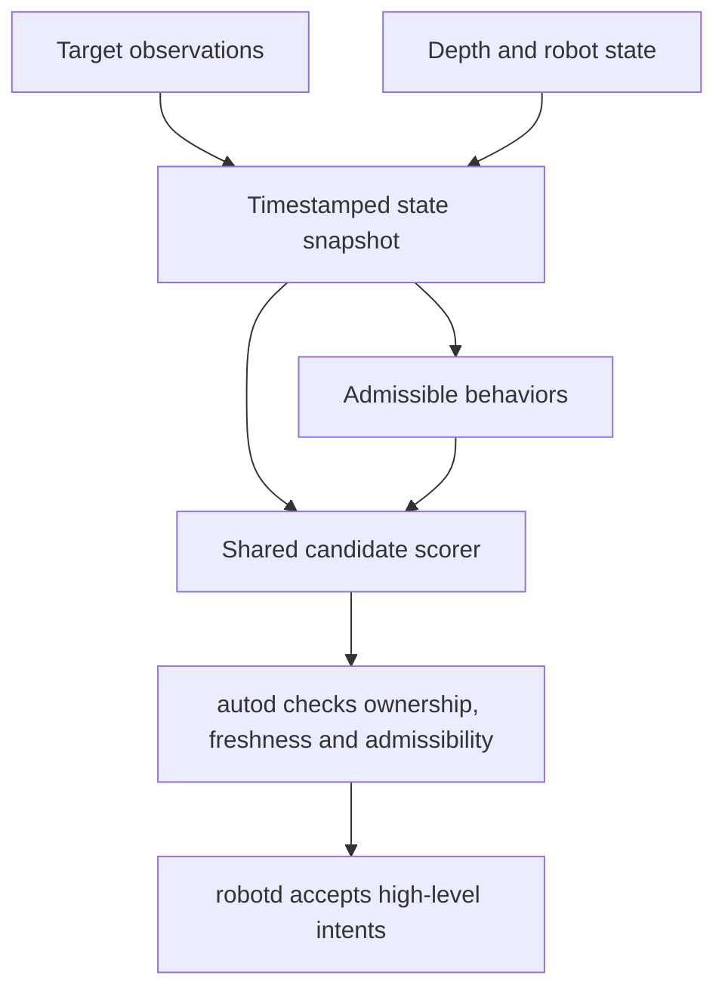

# MicroDuck decision architecture

## Runtime boundary

The offline prototype implements only the scorer. The proposed on-device integration uses the following data flow.

MicroDuck's autonomous client already consumes robot state and depth frames. The design places scoring in an asynchronous worker associated with that client. It uses the latest snapshot, a monotonic timestamp and an ownership generation. Before dispatch, the client checks the timestamp, generation and current admissibility again. An empty candidate set, invalid input, expired result or inference failure defers to the existing controller. The control loop and its existing motor and obstacle protections keep their upstream ownership. The proposed behavior names are local identifiers to map to supported intents during integration.

Upstream references: [autonomous behavior](https://github.com/pollen-robotics/microduck/blob/main/docs/design/autonomous.md) and [service architecture](https://github.com/pollen-robotics/microduck/blob/main/docs/design/architecture.md).

## First forward pass

Each candidate receives the same state vector. Concatenate the state and descriptor, apply a learned affine transform and tanh, then project onto one shared output vector. Softmax spans the admissible candidates. Reordering the candidates reorders the scores. Removing one leaves other logits unchanged and renormalizes their probabilities. The first prototype uses one hidden layer of width 16, two state features and two candidate features, totaling 96 trainable scalars. It uses supervised cross-entropy and a manual SGD update. With two binary descriptors this prototype represents a fixed behavioral vocabulary.

## From snapshots to episodes

Record episode ID, monotonic sample and capture times, detection validity, time since last valid detection, current behavior, candidate IDs and descriptors, expert label, controller decision and transition times. Extend the demo features to include detection age and validity separately before training on sensor logs. Mark episodes with no prior sighting explicitly. Fit normalization on training episodes only.

1. **Offline replay.** Hold out whole sessions. Compare with the existing controller and a simple timeout rule. Report switches per minute, delay to a search decision after sustained loss, and disagreement with reviewed labels. Assess log loss and reliability on held-out episodes.
2. **Shadow execution.** Log proposed decisions without dispatch. Measure sensor-to-decision age, p95/p99 inference latency, peak process memory and missed 20 ms motor deadlines relative to a run with the worker disabled. Check override and stale-result handling.
3. **Deployment comparison.** Benchmark CPU first. If profiling justifies acceleration, export a fixed-shape scorer, convert with RKNN-Toolkit2 for RK3566, and compare INT8 outputs against floating point using representative held-out states. Include transfers and concurrent perception load in timing. Calibration for INT8 activation ranges and calibration of choice probabilities are separate measurements.
4. **Closed-loop evaluation.** After integration checks, compare reacquisition time and successful reacquisition rate across repeated matched trials. Record hardware, firmware, runtime and model versions alongside results.

A [trained CPU export and synthetic replay report](edge-training.md) are available. Device benchmarks are pending. [RKNN-Toolkit2 supported platforms](https://github.com/airockchip/rknn-toolkit2)

## Temporal encoder experiment

The [encoder design record](encoder-design.md) documents the attention mask, candidate representation, and costs of processing an observation window. A one-block Transformer implements this design for offline evaluation. Episode replay will determine whether using the sequence improves behavior selection over the MLP baseline.
